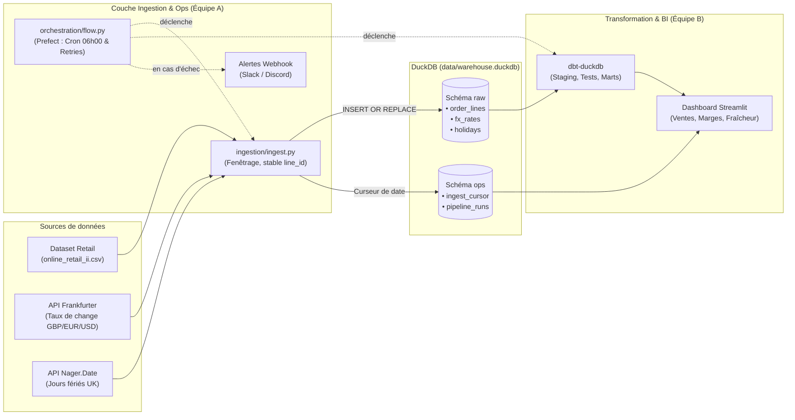

# 🛒 Ecom DataOps Platform

Plateforme DataOps moderne de bout en bout pour l'ingestion, le traitement analytique, l'orchestration et la restitution de données e-commerce internationales.

Ce projet met en œuvre les principes fondamentaux du **DataOps** : idempotence, contrats de données, automatisation de pipeline, observabilité continue et conteneurisation.

---

## 📌 Sommaire

- [Architecture globale](#-architecture-globale)
- [Organisation de l'équipe & Rôles](#-organisation-de-léquipe--rôles)
- [Sources de données & Datasets](#-sources-de-données--datasets)
- [Structure du projet](#-structure-du-projet)
- [Prérequis](#-prérequis)
- [Installation rapide](#-installation-rapide)
- [Guide d'utilisation](#-guide-dutilisation)
  - [1. Ingestion des données (Équipe A)](#1-ingestion-des-données-équipe-a)
  - [2. Orchestration du pipeline (Prefect)](#2-orchestration-du-pipeline-prefect)
  - [3. Exécution avec Docker Compose](#3-exécution-avec-docker-compose)
  - [4. Modélisation et Dashboard (Équipe B)](#4-modélisation-et-dashboard-équipe-b)
- [Observabilité, Audit & Alerting](#-observabilité-audit--alerting)
- [Workflow Git & Bonnes pratiques](#-workflow-git--bonnes-pratiques)
- [Résolution des problèmes fréquents](#-résolution-des-problèmes-fréquents)

---

## 🏗 Architecture globale



---

## 👥 Organisation de l'équipe & Rôles

Le projet est scindé en deux périmètres étanches régis par le contrat [docs/INTERFACE.md](docs/INTERFACE.md) :

| Responsable | Périmètre technique | Dossiers & Fichiers clés |
|---|---|---|
| **Équipe A** (Amont & Infra) | Ingestion multi-source, idempotence, DWH DuckDB, conteneurisation Docker, orchestration Prefect, alertes webhook. | `ingestion/`, `orchestration/`, `Dockerfile`, `docker-compose.yml`, `data/`, `.env.example` |
| **Équipe B** (Aval & Métier) | Modélisation dbt (staging, intermediate, marts), tests de qualité/fraîcheur, contrats, CI GitHub Actions, dashboard Streamlit. | `dbt_project/`, `dashboard/`, `contracts/`, `tests/`, `.github/` |

---

## 📊 Sources de données & Datasets

Le projet combine des données transactionnelles massives avec deux flux d'APIs externes :

### 1. Dataset principal : *Online Retail II* (UCI / Kaggle)
- **Nature :** Transactions réelles d'une boutique en ligne britannique spécialisée dans la vente d'objets cadeaux.
- **Période :** 01/12/2009 au 09/12/2011 (2 ans complets).
- **Volume :** **1 067 372 lignes**.
- **Fichier brut :** `data/online_retail_II.xlsx` (converti en `data/online_retail_ii.csv` via `ingestion/prepare_dataset.py`).
- **Colonnes :** `invoice_no`, `stock_code`, `description`, `quantity`, `invoice_date`, `unit_price`, `customer_id`, `country`.
- **Clé unique stable :** `line_id = invoice_no + "-" + group_cumcount` générée avant tout filtrage pour assurer l'idempotence stricte.

### 2. API Frankfurter (Taux de change)
- **URL :** `https://api.frankfurter.dev/v1/`
- **Rôle :** Récupération quotidienne des taux de change historiques (`base: GBP`, `symbols: EUR, USD`) pour convertir les montants des commandes.

### 3. API Nager.Date (Jours fériés)
- **URL :** `https://date.nager.at/api/v3/PublicHolidays/{year}/GB`
- **Rôle :** Extraction des jours fériés officiels au Royaume-Uni afin d'analyser l'impact calendaire sur les volumes d'achat.

---

## 📁 Structure du projet

```text
├── data/
│   ├── online_retail_ii.csv     # Dataset transactionnel extrait (ignoré dans git)
│   ├── online_retail_II.xlsx    # Fichier Excel source volumineux (ignoré dans git)
│   ├── products.csv             # Référentiel produits
│   └── warehouse.duckdb         # Base de données DuckDB locale (ignorée dans git)
├── docs/
│   ├── ARCHITECTURE.md          # Diagramme d'architecture et responsabilités
│   ├── IDEE.md                  # Cadrage métier et problématiques
│   ├── INTERFACE.md             # Contrat d'interface formel entre A et B
│   ├── TACHES_A.md              # Feuille de route et livrables de l'équipe A
│   └── WORKFLOW.md              # Bonnes pratiques Git, PR et branches
├── ingestion/
│   ├── generate_orders.py       # Générateur synthétique d'origine
│   ├── ingest.py                # Script d'ingestion incrémentale multi-source
│   └── prepare_dataset.py       # Préparation du CSV depuis le classeur Excel
├── orchestration/
│   └── flow.py                  # DAG Prefect (Ingestion -> Freshness -> dbt build)
├── check.py                     # Script d'inspection rapide des tables DuckDB
├── docker-compose.yml           # Déploiement multi-services (dashboard + pipeline)
├── Dockerfile                   # Image Python légère pour les services
├── requirements.txt             # Dépendances Python du projet
├── .env.example                 # Modèle de variables d'environnement
└── .gitignore                   # Exclusion des secrets, caches et bases locales
```

---

## ⚙️ Prérequis

- **Python** 3.12 ou supérieur
- **Git**
- **Docker** et **Docker Desktop** (pour le déploiement conteneurisé)
- Accès Internet lors de l'ingestion (pour joindre les API Frankfurter et Nager.Date)

---

## 🚀 Installation rapide

### 1. Cloner le projet et créer l'environnement virtuel
```powershell
# Cloner le dépôt
git clone <URL_DU_DEPOT>
cd repo

# Créer et activer l'environnement virtuel
python -m venv .venv
.\.venv\Scripts\Activate.ps1       # Sur Linux/macOS : source .venv/bin/activate

# Installer les dépendances
pip install --upgrade pip
pip install -r requirements.txt
```

### 2. Configurer les variables d'environnement
```powershell
Copy-Item .env.example .env        # Sur Linux/macOS : cp .env.example .env
```
Éditer le fichier `.env` selon vos besoins :
- `DUCKDB_PATH` : chemin vers la base (par défaut `data/warehouse.duckdb`).
- `ALERT_WEBHOOK_URL` : URL de webhook Discord ou Slack pour recevoir les alertes d'incident de pipeline.

---

## 📖 Guide d'utilisation

### 1. Ingestion des données (Équipe A)

Le script [ingestion/ingest.py](ingestion/ingest.py) gère le chargement incrémental par fenêtre de temps :

```powershell
# Ingestion standard (avance le curseur selon la fenêtre configurée)
python ingestion/ingest.py

# Backfill sur plusieurs jours (ex: 30 jours consécutifs)
python ingestion/ingest.py --backfill 30

# Ingestion ciblée sur un jour précis (test d'idempotence)
python ingestion/ingest.py --day 2009-12-01
```

> **Garantie d'Idempotence :**
> L'exécution répétée de la commande ci-dessus ne produit aucun doublon grâce aux clauses `INSERT OR REPLACE` sur les clés primaires (`line_id`, `(rate_date, base, quote)`, `(holiday_date, country_code)`).

Pour vérifier les volumes ingérés dans DuckDB :
```powershell
python check.py
```

---

### 2. Orchestration du pipeline (Prefect)

Le script [orchestration/flow.py](orchestration/flow.py) coordonne le DAG complet :
1. `ingest()` : Exécute l'ingestion avec **3 retries automatiques** (délai de 30s) en cas d'indisponibilité réseau.
2. `freshness()` : Valide les seuils de fraîcheur dbt.
3. `build()` : Compile les modèles dbt et exécute les tests de qualité des données.
4. `log_run()` : Enregistre le statut (`SUCCESS` ou `FAILED`) et la durée dans `ops.pipeline_runs`.
5. `alert()` : Notifie le canal Discord/Slack si une étape échoue.

```powershell
# Exécution manuelle immédiate du pipeline
python orchestration/flow.py

# Démarrer le serveur planifié (Cron quotidien à 06h00)
python orchestration/flow.py serve
```

---

### 3. Exécution avec Docker Compose

L'environnement complet peut être lancé dans des conteneurs isolés :

```powershell
# Démarrer le dashboard Streamlit (accessible sur http://localhost:8501)
docker compose up --build

# Exécuter le pipeline ponctuellement dans un conteneur dédié
docker compose --profile pipeline run --rm pipeline

# Arrêter les conteneurs
docker compose down
```

---

### 4. Modélisation et Dashboard (Équipe B)

```powershell
# Vérification du style et tests unitaires
ruff check .
pytest -q

# Exécution de dbt
cd dbt_project
dbt source freshness --profiles-dir .
dbt build --profiles-dir .
cd ..

# Lancement local du dashboard Streamlit
streamlit run dashboard/app.py
```

---

## 📈 Observabilité, Audit & Alerting

La base DuckDB maintient des tables d'audit dans le schéma `ops` :
- **`ops.ingest_cursor`** : Enregistre la dernière date chargée avec succès (`last_day`), assurant la continuité des chargements incrémentaux sans perte ni re-traitement inutile.
- **`ops.pipeline_runs`** : Historique des runs (`run_at`, `status`, `duration_s`, `detail`) interrogé en direct par l'onglet *Santé du pipeline* du dashboard Streamlit.
- **Alertes instantanées :** Tout plantage critique déclenche une requête HTTP POST vers `ALERT_WEBHOOK_URL` avec le message d'erreur tronqué et horodaté.

---

## 🌿 Workflow Git & Bonnes pratiques

Conformément à [docs/WORKFLOW.md](docs/WORKFLOW.md) :
1. La branche `main` est protégée : aucun commit direct n'est autorisé.
2. Tout changement passe par une branche dédiée :
   - `feat/ingestion-api`
   - `feat/dbt-staging`
   - `fix/flow-windows-path`
3. Les commits suivent la convention *Conventional Commits* (`feat: ...`, `fix: ...`, `docs: ...`).
4. Toute modification de table brute dans `raw.*` nécessite une mise à jour préalable du contrat [docs/INTERFACE.md](docs/INTERFACE.md) et une relecture conjointe.

---

## 🛠 Résolution des problèmes fréquents

| Problème rencontré | Cause probable | Solution |
|---|---|---|
| `Lock error` sur `warehouse.duckdb` | DuckDB n'autorise qu'un seul écrivain à la fois. | Fermer le dashboard Streamlit ou le process dbt avant de relancer l'ingestion. |
| `dbt.exe` introuvable sur Linux/Docker | Le code original de `flow.py` cible `dbt.exe`. | Utiliser `dbt` au lieu de `dbt.exe` dans les environnements non-Windows (`shutil.which("dbt")`). |
| Données manquantes dans `raw.orders` | Ingestion non initialisée. | Exécuter `python ingestion/ingest.py --backfill 10`. |
| Script PowerShell bloqué | Politique d'exécution Windows restrictive. | Exécuter `Set-ExecutionPolicy -Scope CurrentUser RemoteSigned`. |
| `ModuleNotFoundError` | Virtualenv non activé. | Activer `.venv\Scripts\Activate.ps1` avant toute commande. |
