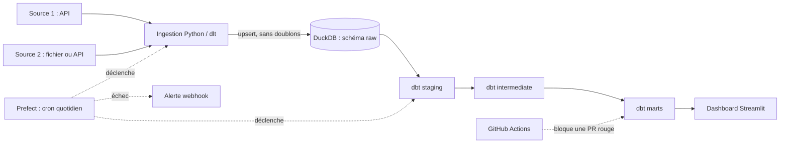

# Architecture visée

Remplacer les noms par ceux de votre sujet, et ajouter votre idée « en plus » au schéma.

## Qui est responsable de quoi
| Couche | Dossier | Responsable |
|---|---|---|
| Ingestion, Docker, orchestration | `ingestion/`, `orchestration/`, `Dockerfile`, `docker-compose.yml` | A |
| dbt, tests, contrats, CI, dashboard | `dbt_project/`, `tests/`, `contracts/`, `.github/`, `dashboard/` | B |
